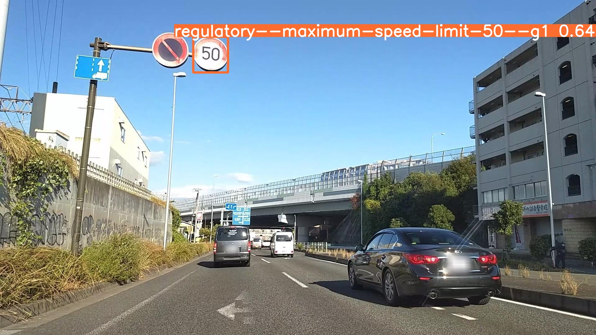
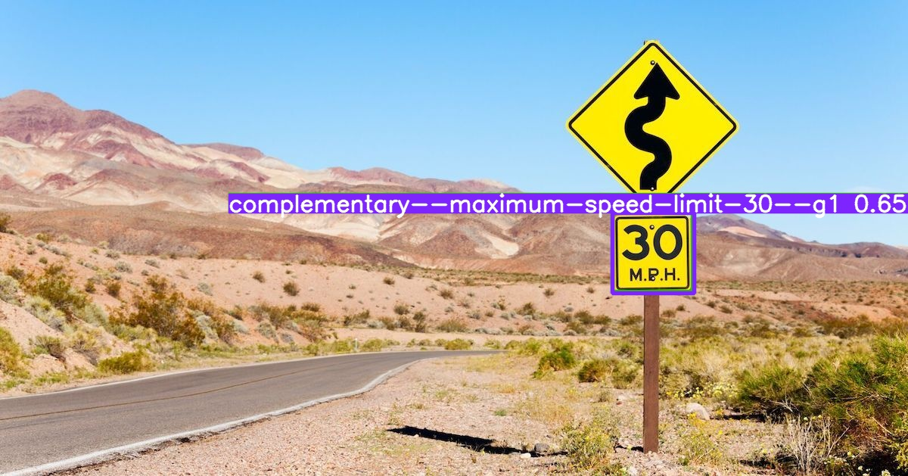
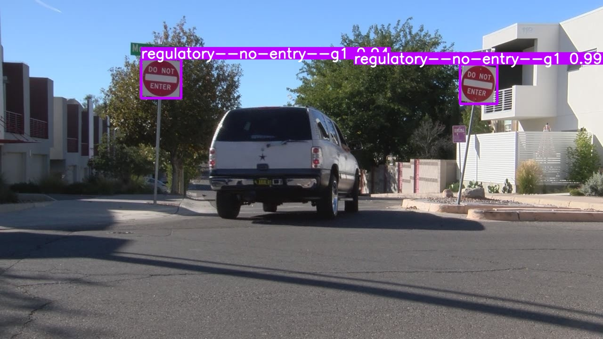
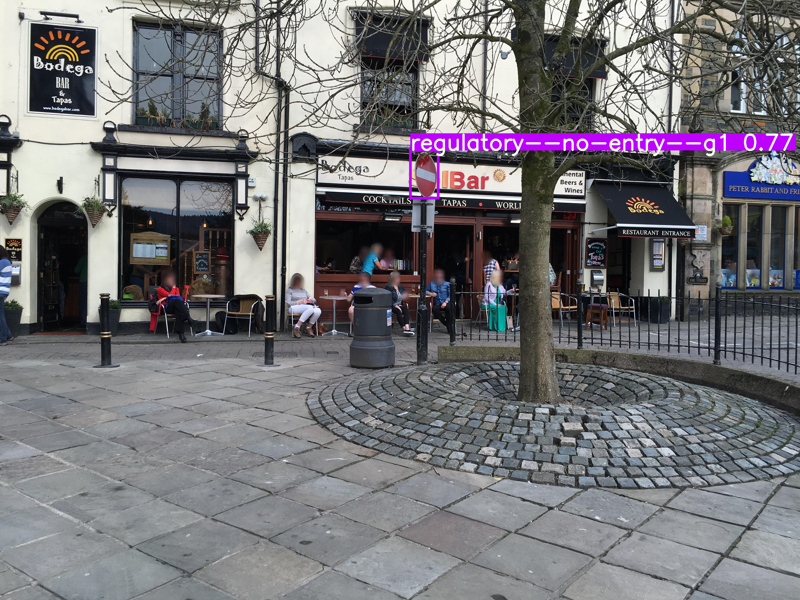
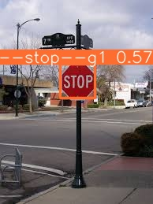
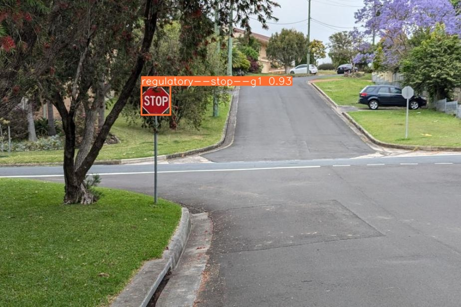
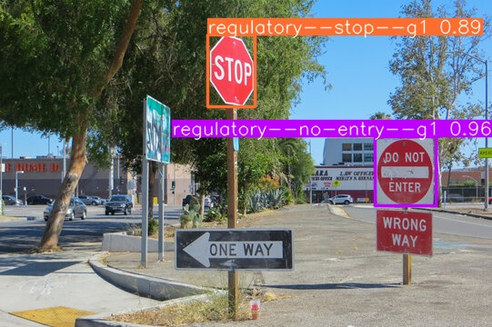

# UGV Autonomous Traffic Sign Detection (YOLOv8)
Deep learning model for real-time identification and classification of **American-Style Traffic Signs** to facilitate autonomous navigation for Unmanned Ground Vehicles (UGVs).

---

### Project Objectives

* **Goal:** Build a detector for the US road signs a UGV needs (speed limit, stop, no entry and others) from a large, real-world street-level dataset.
* **Function:** Implement a model trained exclusively on a subset of the Mapillary Vistas Traffic Sign dataset focused on the **226 relevant US sign classes**.

### Methodology Highlights

* **Architecture:** Utilizes the **YOLOv8** object detection framework.
* **Unique Data Strategy: Class Re-Mapping**
    * The source data is the large **Mapillary Traffic Sign dataset (401 classes)**.
    * The data was then processed, and classes were **remapped and filtered down to 226 specific classes** required for autonomous operation in the United States, optimizing the model's focus and reducing complexity.

### Dataset Source

The core data for this project originates from the official Mapillary Vistas dataset.

* **Dataset Link:** [Mapillary Traffic Sign Dataset](https://www.mapillary.com/dataset/trafficsign)
    * *Note: This repository contains the code and configuration for using the **filtered 226-class version** of the dataset.*

### Training Setup

* **Initialization:** trained **from scratch** (model built from `yolov8.yaml`, random weights), then **fine-tuned** from the best checkpoint.
* **Hardware:** multi-GPU data-parallel training on a Linux GPU server (2 GPUs).
* **Schedule:** 100 epochs, image size 1024, batch 8, cosine learning-rate decay (1e-4 to 1e-5), early-stopping patience 20; fine-tuning 20 epochs.
* **Evaluation:** separate train / validation / test splits; curves, confusion matrices and predictions are in `output_runs/` and `fine_tune_output_runs/`.

### Results (validation set)

| Stage | mAP@50 | mAP@50-95 | Precision | Recall |
|---|---|---|---|---|
| Trained from scratch, 100 epochs | 0.368 | 0.286 | 0.525 | 0.342 |

**Honest read of the numbers:** this is a hard, long-tailed problem: 226 classes, many with only a handful of examples, and many signs that look almost identical. Common, safety-critical signs (stop, no entry, speed limit) are detected well in the samples below, while rare classes pull the average down. The model was still improving at epoch 100 and a short fine-tune did not help, which points to more training, pretrained weights, or grouping rare classes as the next steps.

### Inference Results

Below are samples of the model running on unseen validation data:

**1. Max Speed Sign Detection**

**2. No Entry Sign Detection**

**3. Stop Sign Detection**

